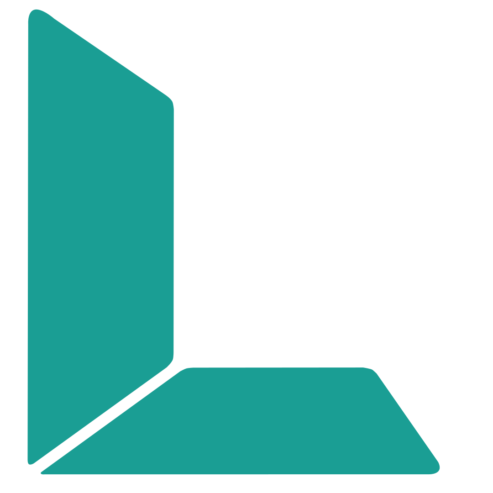

  

  # Lean Browser

  **A Chromium-based browser for calmer, more private browsing.**

Lean Browser is built around a simple idea: everyday browsing should stay under
your control.

## What Lean focuses on

- **Contexts** help keep browsing sessions and site state separate for work,
  personal, banking, and temporary browsing.
- **Lean Guard** blocks ads and trackers in the browser's network layer.
- **Privacy by default** keeps the product focused without extra setup.

- Website: [useleanbrowser.com](https://useleanbrowser.com)
- Download: [useleanbrowser.com/download](https://useleanbrowser.com/download)
- Security: [useleanbrowser.com/security](https://useleanbrowser.com/security)
- Support: [useleanbrowser.com/support](https://useleanbrowser.com/support)

En español: [useleanbrowser.com/es/](https://useleanbrowser.com/es/)
